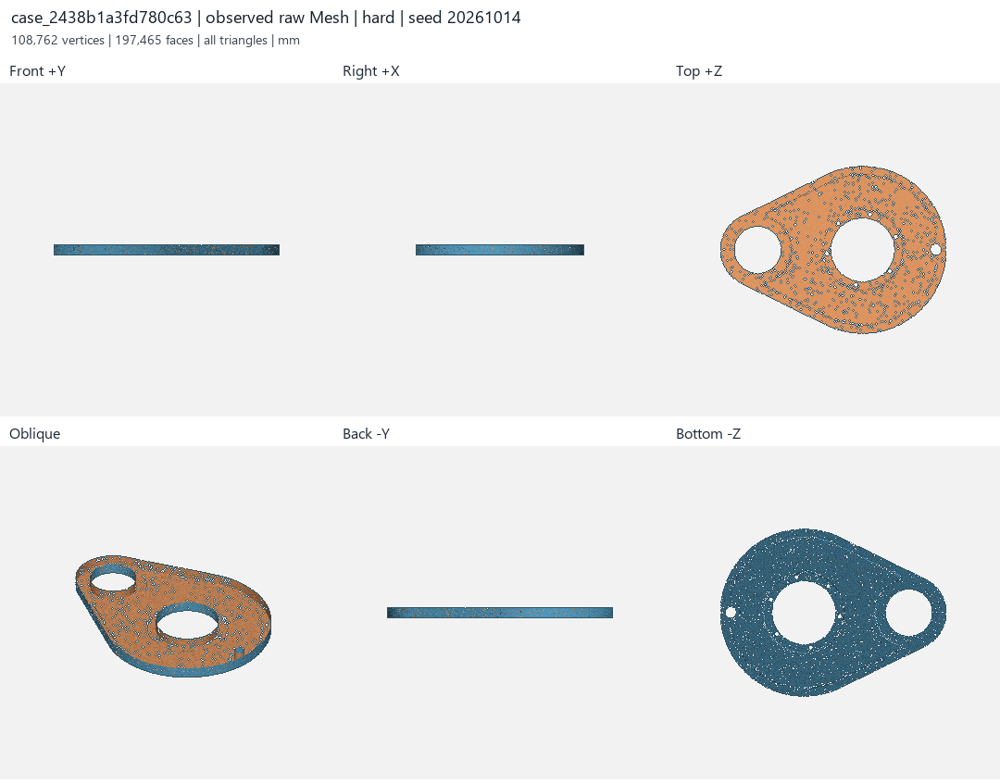

# CADGenBench Mesh Generate

物理桌面扫描模拟与破损 Mesh 生成工程，协作预览版 `v0.1.0-preview`。原长程扫描任务目前暂停，完整数据集尚未完成终验。



当前快照有 **140 例逐例验收通过**，其中 23 个源件各六例，共 138 例；另有一个源件的两例。额外的独立连续自由空间核查已覆盖 138 例。所有数字为此预览快照，未把尚未通过的案例计入。

- 立即查看：[演示 PLY](examples/observed_case/mesh.ply)、[演示 STL](examples/observed_case/mesh.stl)、[单位/坐标/哈希与允许输入](examples/observed_case/metadata.json)。
- 完整单例观测与独立重建包：[Release](https://github.com/zhuoxili-jackie/cadgenbench-mesh-generate/releases/tag/v0.1.0-preview)。包含范围观测、相机、工作点来源和重建代码。
- [全部已验收案例清单](data_index/accepted_cases.jsonl)记录 140 例的哈希、大小、档位与验收状态；当前 Release 只提供上面的一例。
- [数据管理约定](docs/DATA_DISTRIBUTION.md)、[当前限制](docs/SNAPSHOT_STATUS.md)、[协作入口](CONTRIBUTING.md)。

## 环境与入口

实测环境为 Windows / Python 3.12.10，依赖按 `requirements.lock` 锁定。Linux 需要单独验证。

```powershell
python -m venv .venv
.\.venv\Scripts\python.exe -m pip install -r requirements.lock
.\.venv\Scripts\python.exe scripts/scanbench.py --help
```

Release 单例解压后，可在其目录运行 `python rebuild.py --output rebuilt`；输出目录必须为空。重建仅消费公开带噪观测与相机，不读取 STEP、GT、GT 法向或拓扑。

工程的完整流程是 STEP 资格判定 → 真实接触与稳定姿态 → 完整三圈下降螺旋扫描 → 桌面/零件首次命中与遮挡 → 带噪观测 → 统一坐标 → 观测驱动 BPA 与自由空间过滤 → PLY/STL → 独立验收。难度使用实际放置次数与嵌套帧密度。

这里保存实现与协作样例。`scripts/run_full.py`、全量验收及历史修订审计依赖完整工程状态与私有证据包，不能仅凭此代码快照声称全量复现或数据集完成。单例独立重建包不依赖这些私有状态。

## 分工与资料

Generate 负责扫描输入；Repair 见 [scanmesh-toolkit](https://github.com/zhuoxili-jackie/scanmesh-toolkit)。Repair 尚未在本批新数据上完成回归。

协作人：李卓曦 `zhuoxili-jackie`、黄星尧 `au12321ua`。[主计划](https://mcn12m1x8pa4.feishu.cn/wiki/QUzLwk9UDiLf6Hk36qXcSlZJn2c)允许稳定首件先交、后续增量交接；扫描生成环境与星尧的执行环境分开。

源数据固定版本与第三方说明见 [LICENSES.md](LICENSES.md)及 [原始数据卡](sources/DATA_CARD_UPSTREAM.md)。本私有协作仓库未另行授予原创代码的开源许可证。
