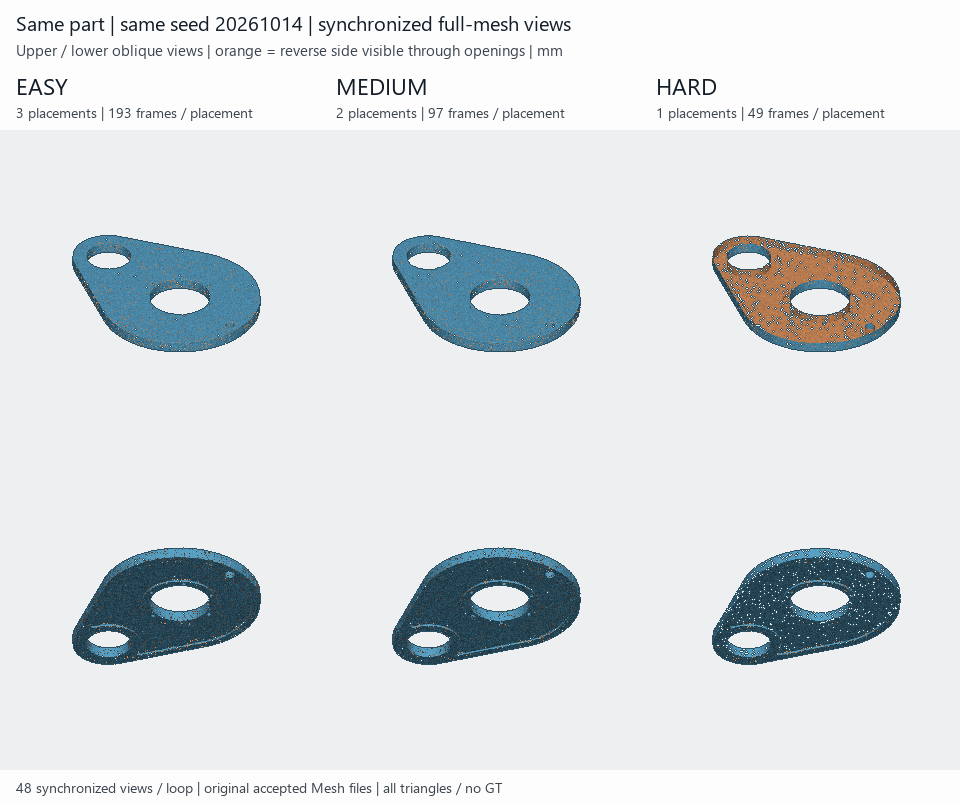

# CADGenBench Mesh Generate

已完成并独立验收：**29 个合格源件 × easy / medium / hard × 两个种子 = 174 例**。固定版本全部 32 个 STEP 均有结论：24 件 native、5 件官方 Mesh 近似、3 件有证据排除。当前物理协议为 `physical_scan_v2_overlap_density`。

## 同一零件的三档案例

下面的旋转动图来自同一零件、同一个种子 `20261014`，按 **easy → medium → hard** 排列。三档视角同步，每帧渲染全部三角形，并采用相同坐标和取景范围。上排与下排分别从上方和下方斜视；橙色表示通过开口看到的三角形背面。动图为 48 帧、约 5.76 秒循环。



[静态三档对比](examples/three_levels/comparison.png)；各档完整六视图见下表。

| | easy | medium | hard |
|---|---|---|---|
| 实际放置次数 | 3 | 2 | 1 |
| 每次放置帧数 | 193 | 97 | 49 |
| 完整六视图 | [easy](examples/three_levels/easy.png) | [medium](examples/three_levels/medium.png) | [hard](examples/three_levels/hard.png) |
| Case ID | `case_3000584756354796` | `case_464615fa87a6774b` | `case_2438b1a3fd780c63` |

hard 同样绕完整三圈；接触面受桌面遮挡。增加可靠放置和路径采样密度带来更多观测。小尺度成网孔隙仍保留，不能把它们全部解释成物理遮挡；没有用补洞抹平缺失。

## 获取全部 174 例

**上传进度：50 个已校验 ZIP 正在上传到草稿 Release；正式 Release 尚未发布。代码、174 例清单和本页 GIF 已更新，下载命令在完整发布后可用。**

**代码、清单和上面的展示图在 Git；完整 STL / PLY 与观测放在 [正式 Release v1.0.0](https://github.com/zhuoxili-jackie/cadgenbench-mesh-generate/releases/tag/v1.0.0)。** 普通 `git clone` 不会下载全量数据。无需 Git LFS。

| 下载类别 | 内容 | 压缩下载大小 |
|---|---|---:|
| `meshes-*.zip` | 全部 174 例 STL、共享顶点 PLY、单位/坐标和采样说明 | 4.44 GiB |
| `previews-*.zip` | 174 例完整六视图及 HTML 索引，无 GT 图 | 42.0 MiB |
| `reconstruction-*.zip` | 相机、配置、观测引用、工作点及来源、重建记录 | 2.66 GiB |
| `observations-*.zip` | 28,160 份共享带噪 range / pixel 数组 | 11.04 GiB |
| `metadata-*.zip` | 完整文件清单、许可、数据卡及观测独立重建入口 | 2.6 MiB |

每个 ZIP 是可独立解压的普通分组包，均小于 1 GiB；**不需要拼接分卷文件**。把所需类别的全部 ZIP 解压到同一个空目录，目录会合并为 `data/cases/`、`data/observations/`、`previews/`。校验文件为 `SHA256SUMS.txt` 与 `release-manifest.json`。

### 一条命令下载

仓库为私有仓库，先用有读取权限的 GitHub 账号登录。脚本使用已保存的 Git 凭据，或进程环境变量 `GITHUB_TOKEN`，不会保存 token。只下载 Mesh 不需要安装几何库。

```powershell
git clone https://github.com/zhuoxili-jackie/cadgenbench-mesh-generate.git
cd cadgenbench-mesh-generate
# 全部 174 例 Mesh + 完整表面预览 + 元数据
python scripts/fetch_release_data.py --preset meshes --destination downloads/v1.0.0 --github-user au12321ua
# 同一目录增量补齐所有相机、工作点和共享带噪观测，已验证的包会复用
python scripts/fetch_release_data.py --preset full --destination downloads/v1.0.0 --github-user au12321ua
```

下载器按 SHA256 校验，支持重新运行及 HTTP 服务允许时的续传。`--case-id` 可只选择包含指定案例的包；一个包也可能含其他案例。下载 `meshes` 预设约 4.48 GiB；`full` 预设约 18.19 GiB。下载时需为 ZIP 与解压数据同时保留空间。

### 仅凭观测独立重建一个案例

```powershell
python scripts/fetch_release_data.py --preset rebuild --case-id case_2438b1a3fd780c63 --destination downloads/one-case --github-user au12321ua
python -m venv .venv
.\.venv\Scripts\python.exe -m pip install -r requirements.lock
.\.venv\Scripts\python.exe downloads/one-case/rebuild.py --case-id case_2438b1a3fd780c63
```

重建只读取带噪观测、相机和配置，输出目录必须为空。`rebuild` 预设不携带已有 Mesh；单个包可能同时包含其他案例的公开工作点。默认输出位于解压目录的 `runs/<case_id>/`。实测环境为 Windows / Python 3.12.10；Linux 尚未单独验收。

## 质量、范围与协作

- [174 例清单](data_index/accepted_cases.jsonl)、[版本与所有下载包](data_index/releases.json)、[验收摘要](docs/generation_acceptance.json)、[数据卡](DATASET_CARD.md)、[分发约定](docs/DATA_DISTRIBUTION.md)、[版本状态](docs/SNAPSHOT_STATUS.md)。
- [小型 PLY 示例](examples/observed_case/mesh.ply)和[STL 示例](examples/observed_case/mesh.stl)可直接查看。29 个匿名 `part_group` 各六例，便于按源件组划分开发/评测；不公开 case→原始 STEP 对应表。
- 整批验收通过，Mesh→观测支持最低 99.8267%，观测→Mesh 保留最低 95.6700%；非法/新增非流形为零。距离均为声明容差下的固定采样指标。
- 19 件不足三种可靠姿态，按实际 1 或 2 种使用；深腔不可达、亚分辨率细节、小尺度 BPA 孔隙、部分源 STEP 的额外参数一致性问题均有明确限制。5 件近似层的参考精度单列；不承诺特定商业扫描仪精度。
- 原长程数据生成 goal 已完成。完整历史原件、GT、来源映射、状态库及缓存不在 Git / Release；全量生成和历史审计脚本需要这些本地证据。发布包可脱离它们进行单例观测重建。
- Generate 提供扫描输入；Repair 工程为 [scanmesh-toolkit](https://github.com/zhuoxili-jackie/scanmesh-toolkit)，本次未运行 repair 或下游实验。协作者 `au12321ua` 已有本仓库 write 权限。

许可及原数据出处见 [LICENSES.md](LICENSES.md)。旧 `v0.1.0-preview` 仅保留为历史首件预览；当前完整数据以 `v1.0.0` 为准。
